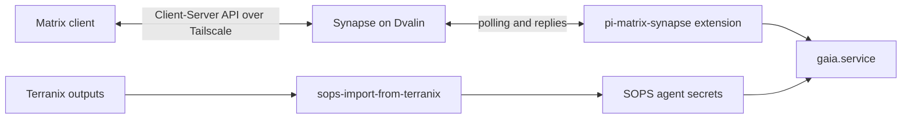

## Initial provisioning

1. Enter `nix develop .#sops` and run Terranix apply with `MATRIX_CREATE_USERS` left false.
2. Run `nix run .#sops-import-from-terranix`. This syncs the Terranix registration
   secret into Dvalin's SOPS file and generated Matrix credentials into each
   matching user's SOPS file.
3. Deploy Dvalin so Synapse starts with the registration secret.
4. Set `TF_VAR_MATRIX_CREATE_USERS=true`, run Terranix apply again, then import
   outputs again. This creates Gaia's account and Matrix admin accounts for every
   normal Dvalin user in `wheel` (currently `jarvahl` and `nixos`).
5. Restart `gaia.service` after the account is created and its credentials are
   imported, then invite `@gaia:matrix.tailbf412b.ts.net` to a private one-to-one
   room.

Federation and public registration are disabled. Gaia responds in one-to-one rooms
containing Gaia and one other homeserver user.

## Manual Pi data migration

The existing Pi data was archived on Dvalin at `/var/lib/gaia-migration/gaia-data.tar`
(root-owned, mode `0600`) and manually restored to
`/home/jarvahl/.local/share/agents/gaia`. The restored directory is owned by
`jarvahl:users` and mode `0700`; Gaia's service runs as `jarvahl`.

The manual restore procedure was:

```sh
systemctl --user stop gaia.service || true
mkdir -p ~/.local/share/agents
sudo tar -xpf /var/lib/gaia-migration/gaia-data.tar -C ~/.local/share/agents
sudo chown -R jarvahl:users ~/.local/share/agents/gaia
chmod -R go-rwx ~/.local/share/agents/gaia
systemctl --user start gaia.service
```

The `assistant` account has been retired, but its home remains on Dvalin under the
now-unmapped UID with mode `0700`. Its `~/.pi/agent/auth.json` was the target of a
symlink in the migrated Pi directory; that credential file has been copied into
`/home/jarvahl/.local/share/agents/gaia/pi/auth.json` with mode `0600`. Keep the old
home and root-only data archive until Gaia's provider authentication and session
history have been verified under `jarvahl`.
